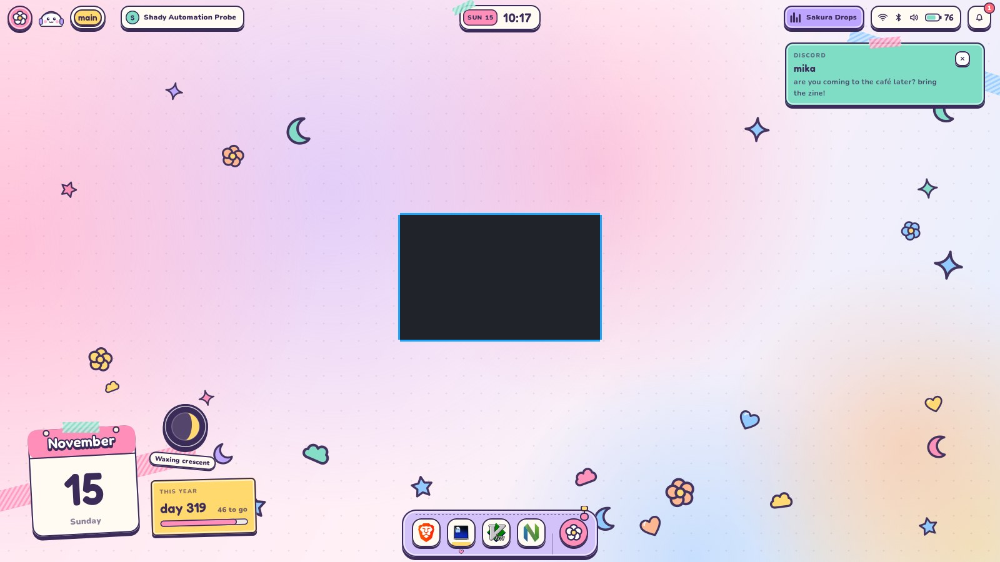
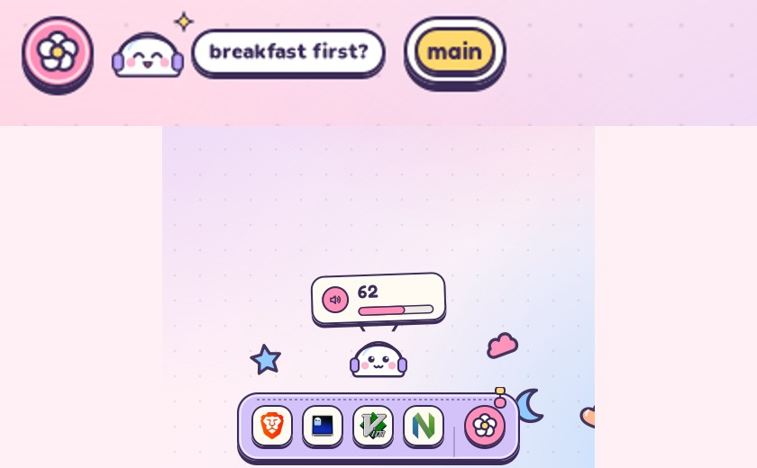
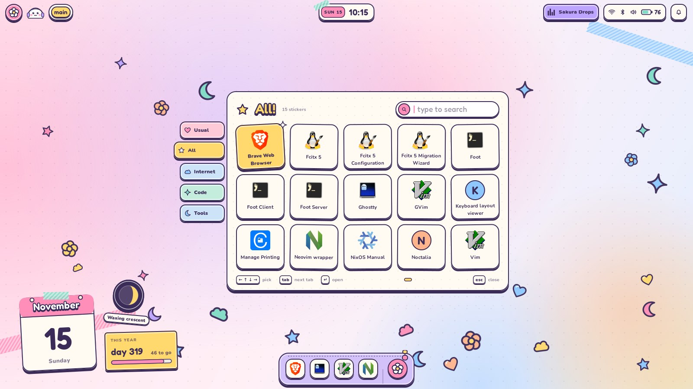
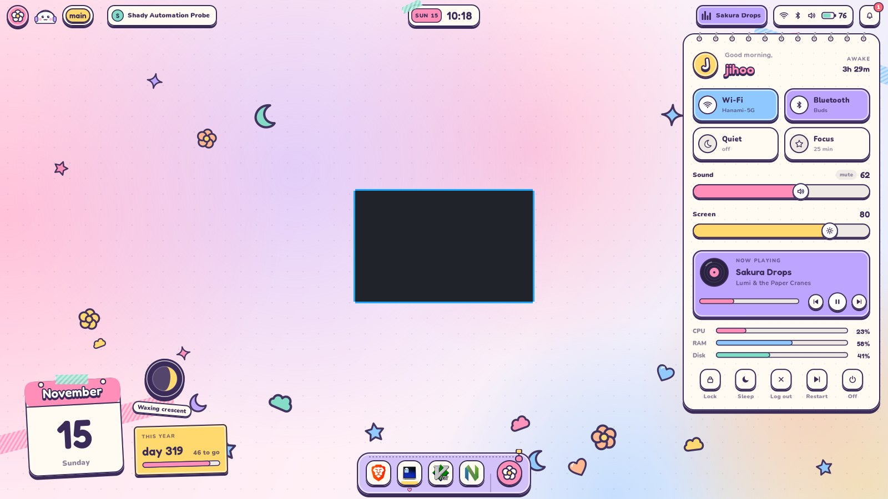
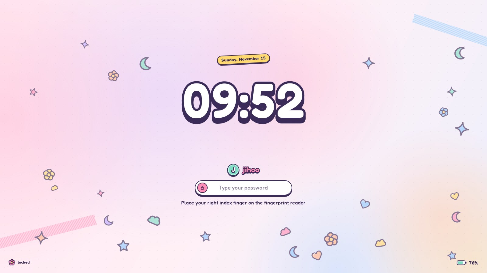

# Washi



A sticker-diary desktop for [Shady](https://github.com/gloaming-dusk/shady).
Every part is a block of paper standing on the page like a keycap: a thick
plum ink outline, a thin light ring inside it, a cream or pastel fill and a
hard shadow straight down. Hold one down and it sinks onto its shadow;
let go and it springs back. Cards pop out with a bounce and are swallowed
when they close, washi tape holds them on, doodles sit in the corners, and
headings are lettered like stickers. Mochi, a little rice cake, lives on
the bar.

Washi is built on [shady-shell](https://github.com/gloaming-dusk/shady-shell):
its springs (`pop`, `jelly`, `clack`), `press` styles, sticker lettering
(`outline`, `text_shadow`), application icons, and the modules without a
look (`machine`, `toasts`, `lockscreen`, `launches`, `focus_timer`,
`almanac`, ...). Washi only draws. Its windows, keys and rules are
[Tide](https://github.com/gloaming-dusk/shady/tree/main/rices/tide)'s:
`config.lua` and `init.lua` start from `shady.base("tide")`.

## What is in it

- **Mochi** sits next to the flower key. It blinks now and then, hops and
  beams when a notification comes in, says something when you click it
  ("drink some water", "bed soon?"), dozes during quiet hours and late at
  night, wears headphones while music plays and a headband while you
  focus. Volume and brightness keys make it pop up at the bottom of the
  screen holding a sign with the level.

  

- **The launcher** (`Super+Space`) is a sticker book. Index tabs stick out
  of its left edge: the usual ones (what you launch most), everything, and
  one per kind of application the machine has (Internet, Code, Media,
  Games, Office, Tools). Each page is a grid of icon stickers that pop onto
  the page in a wave when it is turned; the chosen one tilts and sparkles.
  Arrows pick, Tab turns to the next tab, Page Up/Down or the wheel turn
  pages, and typing searches every application (Hangul input works).

  

- **The pencil case** along the bottom holds the applications you launch
  most (or the ones you pin) and whatever else has a window, each an icon
  on a key that wobbles up like jelly under the pointer. A heart under a key
  means it has a window, and a pink heart means that window has the focus.
- **The bar** has no strip across the screen, only separate blocks: the
  flower key, Mochi, the workspaces, the windows' tabs (right click for
  the window menu), the clock under a piece of tape, the music (with bars
  that hop), the machine, and a bell with today's count (right click: quiet
  hours).
- **The control page** (`Super+S`, or the machine block) hangs on a ring
  binding: a greeting, Wi-Fi, Bluetooth, Quiet and Focus as big keys, sound
  and screen light as chunky sliders, the music on a record, CPU, memory
  and disk, and the session keys (Log out, Restart and Off ask first).

  

- **The day page** (the clock) has the date lettered large, the month as a
  planner with today circled in marker, and today's notifications.
- **Notifications** come as sticky notes in a colour that stays the same
  for each app.
- **The desktop** has its own page (a pastel wash, dotted paper and
  doodles) until you give it a picture, plus stickers in the corner: a
  tear-off calendar page, tonight's moon, and how far through the year
  it is.
- **The lock screen** shows the time in huge sticker letters. A heart pops
  up for each character you type, and a wrong password shakes the strip.

  

The type is [Fredoka](https://fonts.google.com/specimen/Fredoka) and
[Nunito](https://fonts.google.com/specimen/Nunito), both under the SIL Open
Font License (`fonts/`).

## Use it

Washi needs [Shady](https://github.com/gloaming-dusk/shady) (which ships
Tide's compositor side) and a
[shady-shell](https://github.com/gloaming-dusk/shady-shell) with `press`,
the `pop`/`jelly`/`clack` springs, text `outline` and `launches`
([shady-shell#3](https://github.com/gloaming-dusk/shady-shell/pull/3)).

On NixOS, add this flake's package to `programs.shady.rices` and set
`programs.shady.rice = "washi";`:

```nix
{
  inputs.washi.url = "github:jihoo12/shady-rice-washi";
  # ...
  programs.shady.rices = [ inputs.washi.packages.${pkgs.system}.default ];
  programs.shady.rice = "washi";
}
```

Elsewhere, `./install.sh` links this checkout into
`~/.local/share/shady/rices/washi`; then start Shady with `SHADY_RICE=washi`.

To try it from a checkout next to built `shady` and `shady-shell`
checkouts (or with `SHADY_ROOT` and `SHADY_SHELL_BIN` pointing at them):

```bash
nix develop ../shady -c ./run.sh          # nested in a Wayland session
nix develop ../shady -c ./run-native.sh   # directly on a VT (DRM + libinput)
nix develop ../shady -c tests/run.sh      # the headless click-through test
```

## Building on it

A config can start from Washi and change a few things:

```lua
local washi = shell.base("washi", {
    accent = "#7FDCC5",                        -- what is on or chosen
    night = true,                              -- ink-blue paper, cream ink
    dock = { pinned = { "Firefox", "Ghostty" } },
})
washi.mochi.cheer("hello!")
```

The options are `accent`, `night`, `desk = false`, `dock` (`false`, or
`{ pinned = {...} }`, or `{ count = n }`), `mochi = false` and
`wallpaper`. It returns `kit` (the blocks, tape, doodles and lettering in
`washi/kit.lua`), `mochi` and `open` (functions that open its cards).

Keys arrive as Tide's `tide.do`. For words of your own, publish
`washi.do` (`launcher`, `controls`, `day`, `lock`, `dnd`,
`focus [minutes]`, `volume +5`, `mute`, `brightness -5`, `media next`)
from `~/.config/shady/init.lua`:

```lua
local n = 0
shady.bind("Super+d", function() n = n + 1; shady.publish("washi.do", "day " .. n) end)
```

## License

Apache 2.0 (`LICENSE`); the fonts are under the SIL Open Font License.
